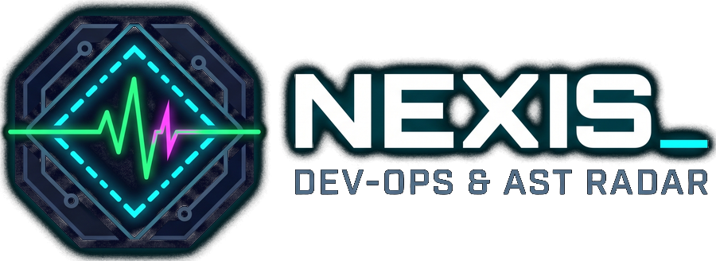

<div align="center">



# NEXIS // Autonomous Software Fleet Observability & Remediation Engine

[](https://nextjs.org/)
[](https://fastapi.tiangolo.com/)
[](https://tailwindcss.com/)
[](https://www.python.org/)
[](https://www.docker.com/)
[](LICENSE)

*A cyberpunk-inspired distributed telemetry console, AST-driven fault localization engine, and automated remediation runtime for modern software fleets.*

[Features](#-key-features) • [Architecture](#-architecture) • [Quick Start](#-quick-start) • [Deployment](#-deployment) • [API & Telemetry](#-telemetry--ingestion-api) • [License](#-license)

</div>

---

## ⚡ Overview

**Nexis** is a full-stack developer platform designed to monitor distributed applications, inspect AST syntax trees in real time, pinpoint runtime exceptions to exact lines of code, and autonomously produce, test, and commit verified remediations.

Featuring a high-contrast tactical HUD interface with real-time acoustic feedback, Nexis unifies error tracing, dependency vulnerability auditing, code quality scoring, and continuous health probing into a single pane of glass.

---

## 🚀 Key Features

### 👤 Live Software Fleet Intelligence
- Enroll any local or cloud application (**Web API**, **Frontend App**, **Microservice**, **Mobile**) with one click.
- Automatic node discovery, health heartbeats, and continuous ingress probing.
- Seamless provider integration for **Vercel** audit logs and cloud deployments.

### 🔍 AST-Grounded Fault Localization
- Syntax tree analysis powered by **Tree-sitter** for Python and TypeScript.
- Pinpoints root-cause stack traces down to specific functions, enclosing classes, and call expressions.
- Eliminates AI hallucination by anchoring prompt contexts strictly to parsed repository source nodes.

### 🛠️ Autonomous Code Remediation Bay
- Deterministic patch generation powered by local **Ollama** (`qwen2.5-coder:7b`) or cloud inference.
- Side-by-side atomic git diff review.
- Automated sandbox test verification runner (**Pytest** / unit tests) prior to applying patches.

### 🛡️ Security Audit & Atomic Auto-Bump
- Comprehensive SAST pattern inspection (hardcoded credentials, SQL sinks, missing security headers).
- Package vulnerability scanner grounded against live lockfiles.
- **Genuine Auto-Bump Pipeline**: Resolves transitive root packages, cleans stale staging lockfiles, executes `npm install`, updates `package.json` / `package-lock.json`, and records genuine Git patches.

### 📊 Code Quality & Complexity Radar
- Cyclomatic complexity metrics, function length distributions, and docstring coverage analysis.
- Instant refactor suggestion triggers.

### 🔊 Cyber Acoustic Feedback Engine
- Web Audio API synthesizer generating real-time computational sound effects and atmospheric background audio.
- Audio HUD control with volume sliders, mute toggles, and track selectors.

---

## 🏗️ Architecture

```
Nexis/
├── frontend/               # Next.js 15 App Router Frontend
│   ├── app/                # Pages (Fleet, Errors, Logs, Remediation, Security, Quality)
│   ├── components/         # CyberCard, CyberButton, AstInspector, Audio HUD, Modals
│   ├── lib/                # Backend API connector, Active Software Context, Web Audio
│   └── public/             # Audio tracks, vector emblems, brand assets
│
├── nexis-backend/          # FastAPI High-Performance Python Backend
│   ├── app/
│   │   ├── api/v1/         # REST Endpoints (Fleet, Vitals, Logs, Remediation, Security, Quality)
│   │   ├── core/           # Security headers, auth validators, configuration
│   │   ├── db/             # SQLite session & schema initialization (WAL mode)
│   │   ├── schemas/        # Pydantic v2 data models
│   │   └── services/       # AST engine, Ollama service, scanner, log watcher, prober
│   ├── data/               # Persistent database storage (ignored by Git)
│   ├── tests/              # Pytest test suite
│   ├── Dockerfile          # Production multi-stage container
│   └── requirements.txt    # Python dependencies
│
├── render.yaml             # Render 1-click Blueprint deployment specification
└── .gitignore              # Strict secret, database, and cache exclusion rules
```

---

## 🏁 Quick Start

### Prerequisites
- **Node.js**: v18.18+ or v20+
- **Python**: 3.11+
- **Ollama** *(Optional for local AI remediation)*: [ollama.ai](https://ollama.ai)

### 1. Clone the Repository
```bash
git clone https://github.com/danitech887/nexis.git
cd Nexis
```

### 2. Configure Backend
```bash
cd nexis-backend

# Create virtual environment
python3 -m venv venv
source venv/bin/activate

# Install dependencies
pip install -r requirements.txt

# Create environment configuration
cp .env.example .env
```

Start the backend daemon:
```bash
uvicorn app.main:app --host 0.0.0.0 --port 8000 --reload
```
*API Swagger documentation available at: `http://localhost:8000/api/v1/docs`*

### 3. Configure Frontend
In a new terminal window:
```bash
cd frontend

# Install packages
npm install

# Create environment configuration
cp .env.example .env.local

# Run Next.js development server
npm run dev
```
*Open [http://localhost:3000](http://localhost:3000) in your browser.*

---

## 🚢 Deployment

### Deploy Backend to Render

Nexis includes a zero-config [render.yaml](render.yaml) Blueprint:

1. Open [Render Dashboard](https://dashboard.render.com/) and click **New +** ➔ **Blueprint**.
2. Select your `nexis` repository.
3. Render automatically provisions the web service with:
   - **Root Directory**: `nexis-backend`
   - **Build Command**: `pip install -r requirements.txt`
   - **Start Command**: `uvicorn app.main:app --host 0.0.0.0 --port $PORT`
   - **Health Check Path**: `/health`
4. Copy your backend live URL (e.g., `https://nexis-backend.onrender.com`).

### Deploy Frontend to Vercel

1. Open [Vercel](https://vercel.com/new) and import your `nexis` repository.
2. In **Project Settings**:
   - **Root Directory**: Set to `frontend` *(Important)*.
   - **Framework Preset**: *Next.js*.
3. Add Environment Variables:
   ```env
   NEXT_PUBLIC_NEXIS_BACKEND_URL=https://your-backend-name.onrender.com/api/v1
   NEXT_PUBLIC_API_URL=https://your-backend-name.onrender.com
   ```
4. Click **Deploy**.

---

## 📡 Telemetry & Ingestion API

Enrolled client applications stream telemetry directly into Nexis via HTTP REST:

### Ingest Log Entry
```http
POST /api/v1/telemetry/ingest
Content-Type: application/json
X-API-Key: your_software_ingest_token

{
  "system_id": "shulebase-api",
  "level": "ERROR",
  "tag": "DatabaseError",
  "msg": "OperationalError: connection to server on socket failed",
  "stack_trace": "Traceback (most recent call last):\n  File 'views.py', line 42...",
  "metadata": {
    "endpoint": "/api/v1/students/",
    "status_code": 500
  }
}
```

---

## 🧪 Testing

Run backend test suites:
```bash
cd nexis-backend
pytest -v
```

Test production frontend build:
```bash
cd frontend
npm run build
```

---

## 🔒 Security & Data Privacy

- **No Secrets in Source**: All API keys, database files, and private credentials are kept strictly out of git history via `.gitignore`.
- **Deterministic AI Context**: Remediation models only receive AST-extracted function contexts rather than entire codebases.
- **Local LLM Capable**: Fully functional offline with local Ollama models (`qwen2.5-coder:7b`) without sending proprietary code to external APIs.

---

## 📄 License

This project is licensed under the MIT License - see the [LICENSE](LICENSE) file for details.
